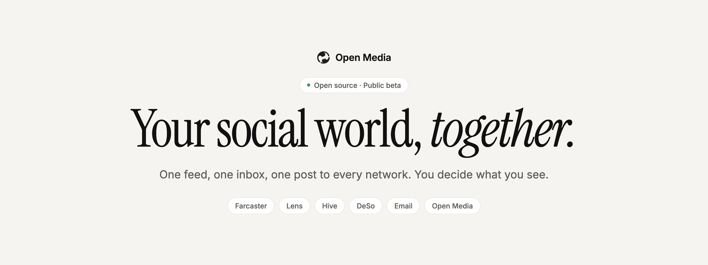
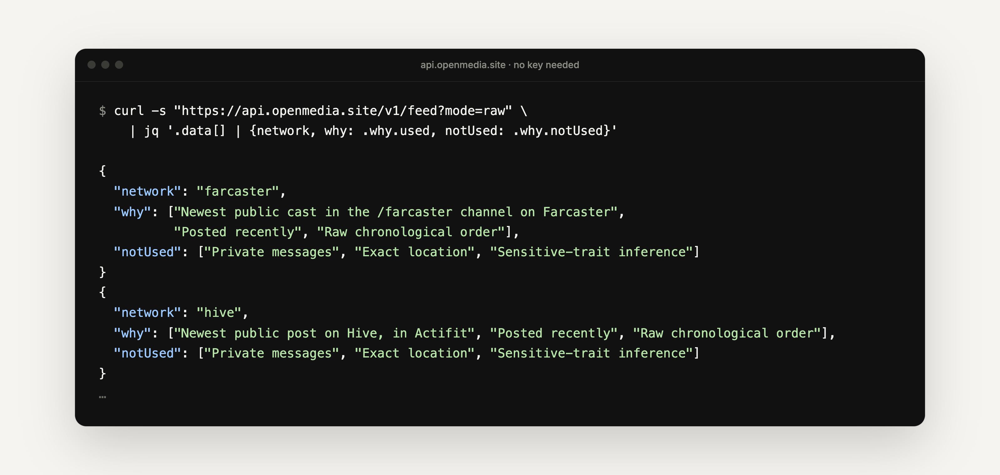

<p align="center">
  <a href="https://openmedia.site">
    <picture>
      <source media="(prefers-color-scheme: dark)" srcset=".github/assets/banner-dark.png">
      
    </picture>
  </a>
</p>

<p align="center">
  <strong>Post everywhere. Message everyone. One app.</strong><br>
  A free, open-source app for iPhone, Android and the web where <em>you</em>, not a platform, own your identity, audience and feed.
</p>

<p align="center">
  <a href="https://openmedia.site"><strong>Website</strong></a> ·
  <a href="https://api.openmedia.site/docs"><strong>API docs</strong></a> ·
  <a href="https://api.openmedia.site/agents"><strong>For agents</strong></a> ·
  <a href="docs/TECHNICAL_OVERVIEW.md"><strong>Technical overview</strong></a> ·
  <a href="CONTRIBUTING.md"><strong>Contribute</strong></a>
</p>

<p align="center">
  <a href="LICENSE"></a>
  
  
  <a href="https://github.com/mihirkavi/open-media/stargazers"></a>
</p>

<p align="center">
  
</p>

## Why Open Media

Your friends are on one app, your colleagues on another, your family on a third, and your email lives somewhere else. Each app ranks what you see with a secret algorithm, and each one keeps your followers and history if you leave.

**Open Media sits on top of the networks you already use.** Read everything in one feed, talk to everyone from one inbox, and publish once to every network you pick. It is useful on day one, even before any of your friends join.

<table>
  <tr>
    <td width="33%" valign="top">
      <h3>🌐 Everything together</h3>
      Posts from several networks in one feed. Chats and email in one inbox, organised by <em>person</em> rather than by app. One post to every network.
    </td>
    <td width="33%" valign="top">
      <h3>🧭 Your feed, your rules</h3>
      Choose <strong>Raw</strong> (newest first) or <strong>Relevant</strong> (a few visible signals). Every ranked post has a <strong>Why this?</strong> button that also lists the private data it did <em>not</em> use.
    </td>
    <td width="33%" valign="top">
      <h3>🚪 Never locked in</h3>
      Export everything or delete your account at any time. Your public posts are open to everyone through a free API. The long-term goal is identity that works in any app.
    </td>
  </tr>
</table>

> **Apps are doorways. The person is the constant.**

## A quick tour

Three screens: **Feed**, **Clips** and **Messages**. Search, settings and your profile stay out of the way until you need them.

<p align="center">
  
</p>

<table>
  <tr>
    <td width="50%" valign="top">
      
      <h4>Why this?</h4>
      Every ranked post explains itself: the reasons, the filters, and the private data that was not used.
    </td>
    <td width="50%" valign="top">
      
      <h4>One search for everything</h4>
      Posts on every network, your messages, email and settings, in plain language. Private data is searched on your device.
    </td>
  </tr>
  <tr>
    <td width="50%" valign="top">
      
      <h4>Write once, publish everywhere</h4>
      The composer shows exactly where a post will go. Leave any network out for a single post.
    </td>
    <td width="50%" valign="top">
      
      <h4>Light and dark, everywhere</h4>
      A calm black-and-white design that puts content first, on phones, tablets and the web.
    </td>
  </tr>
</table>

<p align="center">
  
  <br><sub><strong>Messages:</strong> Open Media chats and your email side by side, organised by person. Reply to an email like a text.</sub>
</p>

<sub>Screenshots are from the current app. Feed and Clips show real public posts from open networks; the conversations are test data.</sub>

## How it works

<p align="center">
  
</p>

Each network tells the app what it genuinely allows (reading, posting, messaging), and the app only shows those actions. Open Media never pretends a connection exists, never scrapes, and never asks for a seed phrase or master password.

## What works today

Open Media is in **public beta**. Everything marked ✅ is live in the code today.

| | Feature | Status |
| --- | --- | --- |
| 📰 | **Feed** mixing Open Media, Farcaster, Lens, Hive and DeSo, with Raw and Relevant modes. No account needed to read. | ✅ Live |
| 🎬 | **Clips**: full-screen short videos from the same networks. | ✅ Live |
| ✍️ | **Posting**: text and videos up to 3 minutes, with location data stripped before upload. | ✅ Live |
| 💬 | **Messages**: real-time chats between Open Media users, with blocking and reporting. | ✅ Live |
| 📧 | **Email**: Gmail, iCloud, Yahoo, Fastmail or any IMAP account, read and answered as conversations. | ✅ Live |
| 🔎 | **Search** across networks, messages, email and settings, with a short AI summary of public results. | ✅ Live |
| 👤 | **People**: one profile per person across networks, plus private, encrypted contacts and notes. | ✅ Live |
| 🔐 | **Your data**: export everything or delete your account from your profile. | ✅ Live |
| 🤖 | **Developers and AI agents**: public API, account API, MCP servers, `llms.txt` and OpenAPI. | ✅ Live |
| 📣 | **Cross-posting** to Farcaster, Lens, Hive and DeSo with keys you approve in each network's app. | 🧪 Beta |
| ✅ | **Private accounts, follows and verification** (blue tick via Stripe Identity once configured). | 🧪 Beta |
| 🛍️ | **Products, services and events**, with Bay Area events from Luma, Meetup and Eventbrite. | 🧪 Beta |
| 💳 | **Payments and tips** by card (Stripe) or USDC on Base. Open Media never holds money. | 🧪 Test mode |
| 🇮🇳 | **Sell on ONDC**: Indian sellers' catalogs offered to every ONDC buyer app. | 🧪 Not yet registered |
| 🌉 | **Chat bridges** for WhatsApp, Signal, Instagram, Slack, Discord and more. | 🧪 Local setup only |

<details>
<summary><strong>Details and caveats for each beta feature</strong></summary>
<br>

- **Cross-posting** is built on each network's official tools but has not yet been tested end to end on live networks. No seed phrases are ever requested.
- **Verification** turns on once Stripe Identity is configured; until then nobody has a blue tick.
- **Products and services** can be listed from the composer with a price. Verified people can rate listings from one to five stars. Events cover the San Francisco Bay Area for now and link to each official registration page.
- **Payments** show the recipient, amount and fees before anything happens. Card payments go straight to the seller's Stripe account; USDC goes from your own wallet. Test cards and Base Sepolia only until live keys are approved. No fees for now.
- **ONDC**: Sellers in India can open an ONDC store from their profile, and Open Media's seller app answers signed catalog searches and price quotes. Open Media must first register with ONDC, and orders come in a later phase ([ADR 0015](docs/adrs/0015-ondc-seller-app.md)).
- **Chat bridges** use open-source [mautrix](https://docs.mau.fi/bridges/) bridges (WhatsApp, Signal, Google Messages, Google Voice, Instagram, Messenger, LinkedIn, X, Bluesky, Slack, Discord, and Telegram once its app ID is set). They run only on a local setup, are opt-in with a clear warning, and are not approved by those companies. See [services/bridges](services/bridges).

</details>

## For developers and AI agents

Everything Open Media does for people, it also offers to programs and AI assistants, through documented interfaces that share the app's own code. Public data needs no key.

<p align="center">
  
</p>

| Interface | What it gives you |
| --- | --- |
| **[Public API](https://api.openmedia.site/docs)** | The mixed feed with “Why this?” reasons, cross-network search, profiles, events and network capabilities. No key. |
| **Account API** | Post, message, manage contacts, pay and export, acting only as the signed-in person. |
| **MCP servers** | The same as tools for Claude, ChatGPT and other assistants: `/open/mcp`, `/me/mcp` and `/docs/mcp`. |
| **[Agent plugin](agent-plugin)** | One install for Claude Code and Codex: three MCP servers and two skills. |
| **[SDK, CLI and Python](packages)** | A typed TypeScript SDK, an `open-media` command line and a Python client. |

Add Open Media to any MCP client:

```json
{ "mcpServers": { "open-media": { "url": "https://api.openmedia.site/open/mcp" } } }
```

Or install the plugin:

```text
/plugin install open-media --marketplace mihirkavi/open-media
```

```bash
codex plugin marketplace add mihirkavi/open-media && codex plugin add open-media@open-media
```

<details>
<summary><strong>Every endpoint, discovery file and sign-in step</strong></summary>
<br>

| Interface | Account needed | What you can do |
| --- | --- | --- |
| `GET /v1/feed`, `/v1/search`, `/v1/posts`, `/v1/profiles/{handle}`, `/v1/people/{network}/{handle}`, `/v1/events/upcoming`, `/v1/networks`, `/v1/settings`, `/v1/about` | No | Read the mixed feed with “Why this?” reasons, search every open network, read public posts and profiles, one person's posts across networks, upcoming events, network capabilities, settings and the mission |
| `/v1/me`, `/v1/me/posts`, `/v1/me/conversations`, `/v1/me/contacts`, `/v1/me/identity`, `/v1/me/follows`, `/v1/me/listings`, `/v1/me/payments`, `/v1/me/export` | Your access token | Publish, delete and report posts, offer products and services, pay, tip and unlock (always previewed and confirmed first), read and send messages, manage contacts, privacy and follows, export your data |
| MCP: `/open/mcp`, `/me/mcp` and `/docs/mcp` | No / your access token / no | The same as tools, plus searchable documentation |
| WebMCP | No | Every page of the API site and the web app registers read-only tools through `document.modelContext` |
| `POST /ask` (NLWeb v0.55) | No | Ask in plain language; answers are schema.org items, as JSON or a stream |
| `POST /agent/identity` | No | An agent registers itself and trades the assertion at `/oauth/token` (JWT-bearer grant) for a read-only token with its own rate limit |
| Discovery | No | `/llms.txt`, `/agents.md`, `/auth.md`, `/docs`, `/v1/openapi.json`, `/sitemap.xml`, `/.well-known/ard.json`, `/.well-known/agent-skills/index.json`, `/.well-known/agent-card.json`, `/.well-known/api-catalog`, `/schemamap.xml`, `/feeds/posts.jsonl` and MCP server cards; every page also answers in Markdown (`Accept: text/markdown` or `.md`) |

**Signing an agent in.** An agent signs you in the same way the app does: it asks for your email, Open Media emails you a code from security@openmedia.site, and you tell the agent the code (`POST /v1/auth/email-code`, then `POST /v1/auth/verify`, or the `request_sign_in_code` and `sign_in_with_code` MCP tools). From a terminal, `open-media login you@example.com` does the same, and `export OPEN_MEDIA_TOKEN=$(open-media token)` hands the session to the plugin. You can also copy a token from **Settings → Developers and agents**. Tokens expire after about an hour and renew with the refresh token. Every account call acts only as you; the database refuses anything else.

**Packages.** The SDK (`open-media-sdk`), CLI (`open-media`: `feed`, `search`, `events`, `profile`, `timeline`, `me`, `post --yes`, `payments`, `mcp-config`, all with `--json`) and Python client are not on npm or PyPI yet; build them from source ([packages/README.md](packages/README.md)). `npm run packages:test` runs their tests.

See [ADR 0012](docs/adrs/0012-agent-interfaces-and-design-system.md) and the [public API guide](services/mail-sync/PUBLIC_API.md).

</details>

## Run it yourself

One TypeScript codebase ([Expo](https://expo.dev) and React Native) for iPhone, Android and the web, with [Supabase](https://supabase.com) for accounts and data and a [Cloudflare Worker](https://workers.cloudflare.com) for email, the public API and events.

**You need:** Node.js 22.13+ (`nvm use`), npm and Docker Desktop. Xcode or Android Studio only for the phone simulators.

```bash
git clone https://github.com/mihirkavi/open-media.git
cd open-media
npm install
npm run local
```

That starts everything locally (database, sign-in, email service, public API and web app) and opens <http://localhost:8081>. Sign-in codes go to a local test inbox and are filled in for you. Stop the database with `npm run local:stop`.

| Command | What it does |
| --- | --- |
| `npm run ios` / `npm run android` | Run on a phone simulator |
| `npm run check` | Typecheck, app and Worker tests, and the web export |
| `npm run test:db` | Database tests |

## How it is different

| | Big social apps | Aggregators and unified inboxes | **Open Media** |
| --- | :---: | :---: | :---: |
| Brings several networks together | — | Some | ✅ |
| Messaging and email in one place, by person | — | Some | ✅ |
| You choose how your feed is ranked | — | Rarely | ✅ |
| Explains what data is *not* used | — | — | ✅ |
| Full export and account deletion | Partly | Partly | ✅ |
| Open source | — | Usually not | ✅ MIT |
| Public posts open to everyone, including AI agents | — | — | ✅ |
| Advertising | Core business | Varies | None by default |

## The bigger vision

> **Build the open communication layer for humanity:** people talk across networks, control how information reaches them, and keep their identity, relationships and content whichever app they use.

Open Media starts as an app, but the aim is an **open protocol** that many apps can share, so no company, including Open Media itself, can lock people in. If Open Media the company disappeared, the network should keep running.

| Phase | What it delivers | Status |
| --- | --- | --- |
| **1. The app** | Feed, Clips and Messages on iPhone, Android and web | ✅ Done |
| **2. Shared content** | One post type, four open networks, short video | ✅ Done |
| **3. Email and Messages** | Email inside Messages, chats organised by person | ✅ Done |
| **4. Connectors** | Cross-posting, chat bridges, public API | 🧪 In beta |
| **5. Search and AI help** | One plain-language search for everything | ✅ First version |
| **6. Algorithm choice** | A marketplace of feed algorithms with strict data permissions | 🔜 Next |
| **7. Moderation choice** | User-set filters, credible reports, independent moderators | 🔜 Planned |
| **8. Identity** | Optional proof of personhood, separate personas, portable identity | 🔜 Planned |
| **9. Governance** | One person, one vote, and an open proposal process | 🔜 Planned |
| **10. Decentralisation** | Independent apps and infrastructure, stewarded by a foundation | 🔭 Long term |

<details>
<summary><strong>What the vision means in practice</strong></summary>
<br>

- 🧭 **Algorithms you can choose.** Feed algorithms become optional "lenses" anyone can create, inspect, rate, install or remove. Each declares the data it uses and can never touch private messages, ID documents or exact location.
- 🛡️ **Safety without censorship by default.** Filtering is normal; global deletion is exceptional. You, your communities and your region choose filters, including from independent moderation providers. Report counts are weighed by credibility, never an automatic delete button.
- 🙋 **Real people, private by default.** Optional proof that you are a real, unique human, without storing your passport or biometrics. Keep separate personas that cannot be publicly linked.
- 🗳️ **One person, one vote.** The protocol is governed by verified people, never by tokens or money. Core rights (algorithm choice, portability, the right to fork) are protected from easy change.
- 🔗 **Blockchain proves; it does not host.** Used only where it adds trust, such as authorship or votes. You never need a wallet, tokens or gas to post or chat.
- 🤖 **Honest about AI.** Agents take part only as clearly labelled agents, AI media is disclosed, and agents cannot message you unless you allow it.
- 🔒 **Private messages stay private.** Open Media's own messages will use mature, reviewed end-to-end encryption, and email and bridged chats are always labelled honestly.
- 💸 **Money buys services, not power.** No ads by default, no required token, no speculative coin. Creators earn through subscriptions, tips and memberships.

</details>

<details>
<summary><strong>Principles, why now, and who it is for</strong></summary>
<br>

**Principles**

- Post everywhere. Message everyone. One app.
- Your feed belongs to you.
- Your identity, audience and content move with you.
- Apps are doorways. The person is the constant.
- Protocol rules decide how apps work together. Each app decides how things look.
- Build one app today as though competing apps will exist tomorrow.
- Obvious before powerful, and powerful when needed.

**Why now**

1. **Open social networks are real.** Farcaster, Lens, Hive and DeSo let any app read and publish without a gatekeeper. The average internet user is active on about seven social platforms a month ([DataReportal, Digital 2025](https://datareportal.com/reports/digital-2025-global-overview-report)).
2. **People are tired of being the product.** Frustration with opaque feeds is mainstream, and regulators now require more transparency and portability.
3. **AI assistants need open, trustworthy data.** Open Media's public posts are open to agents by design.
4. **One codebase can reach every device**, so a small team can ship one polished app to iPhone, Android and the web.

**Who it is for**

- **People** who want one calm place for their friends, feeds and inbox, with a feed they control.
- **Creators** who want to reach every network with one post and keep their audience.
- **Developers and AI builders** who want open access to public posts and a clean codebase.
- **Partners and investors** who believe the next era of social media is open and user-owned.

The complete vision is in the [Master Builder Prompt](Open%20Media%20%E2%80%94%20Master%20Builder%20Prompt.md), with a shorter summary in [docs/MASTER_BUILDER_PROMPT.md](docs/MASTER_BUILDER_PROMPT.md).

</details>

## Honest status

Open Media is an early beta, built in the open:

- Cross-posting is built on each network's official tools but has **not yet been tested end to end** on live accounts.
- Chat bridges run **only on a local setup**, have not been connected to real accounts, and are not approved by those companies, so accounts could be limited. iMessage, Snapchat and TikTok cannot be bridged.
- The ONDC seller app is tested against ONDC's published signing example and a simulated buyer app, but Open Media is **not yet registered with ONDC**. It answers catalog searches and quotes only.
- Videos are stored as uploaded, without streaming optimisation.
- Messages between Open Media users are protected by strict database rules but are **not yet end-to-end encrypted**.
- The algorithm marketplace, moderation choice, identity and governance are the vision, not features you can use today.

Every limitation is listed in the [technical overview](docs/TECHNICAL_OVERVIEW.md#honest-limitations).

## FAQ

<details>
<summary><strong>Is Open Media free?</strong></summary>
<br>
Yes. The app and its source code are free and open source under the MIT license, with no ads by default.
</details>

<details>
<summary><strong>Do my friends need to join for it to be useful?</strong></summary>
<br>
No. It connects the networks and email accounts you already use. Friends on Open Media are a bonus, not a requirement.
</details>

<details>
<summary><strong>Can it show my Instagram, X, TikTok or LinkedIn feed?</strong></summary>
<br>
Not today. Those companies do not offer open access for apps like Open Media, and Open Media does not scrape them. It connects to networks that allow it (Farcaster, Lens, Hive, DeSo and email) and will add others as official access becomes available. For messaging only, optional open-source bridges can bring in chats from WhatsApp and similar apps, with a clear warning first.
</details>

<details>
<summary><strong>Do I need a crypto wallet?</strong></summary>
<br>
No. You sign in with your email. Some open networks use blockchain technology behind the scenes, but you never need to understand it, hold tokens or pay fees to read the feed.
</details>

<details>
<summary><strong>Is my data safe?</strong></summary>
<br>
Your messages, email and contacts are private and never shown publicly. Email passwords are encrypted on the server, and the database only lets each person see their own data. You can export everything or delete your account at any time. Open Media's own messages are not end-to-end encrypted yet; that is planned using a mature, reviewed standard.
</details>

<details>
<summary><strong>Who owns my posts?</strong></summary>
<br>
You do. Posts you publish on Open Media are public and open to everyone through a free API, so your words are not trapped inside one company. You can delete a post at any time, although copies others already saw cannot be recalled.
</details>

<details>
<summary><strong>How does Open Media make money?</strong></summary>
<br>
The protocol does not require any single business model. The app ships with no ads by default. Future options include optional paid services (extra storage, premium algorithms or moderation providers) and creator tools. Money will never buy influence over how the protocol is governed.
</details>

## Learn more

| Document | What it covers |
| --- | --- |
| [Technical overview](docs/TECHNICAL_OVERVIEW.md) | Every feature, the architecture, configuration and known limitations |
| [Public API](services/mail-sync/PUBLIC_API.md) | Reading public Open Media posts and profiles as JSON |
| [Architecture decisions](docs/adrs) | The short records behind each major choice |
| [Open Media Events](docs/events/README.md) | The event-planning service for AI assistants |
| [Production readiness](docs/PRODUCTION_READINESS.md) | What is needed to run Open Media in production |

## Contributing

Contributions of every size are welcome: bug reports, ideas, design feedback, documentation and code.

- Read [CONTRIBUTING.md](CONTRIBUTING.md) to get set up and learn how changes are reviewed.
- Open an [issue](https://github.com/mihirkavi/open-media/issues) to report a bug or suggest an idea.
- Report security problems privately as described in [SECURITY.md](SECURITY.md).

The `main` branch is protected: every outside change goes through a pull request reviewed by the maintainer.

## License

Released under the [MIT License](LICENSE).

<p align="center">
  <br>
  <picture>
    <source media="(prefers-color-scheme: dark)" srcset=".github/assets/logo-dark.png">
    
  </picture><br>
  <sub><strong>Open Media</strong> · Your social world, together.</sub>
</p>
