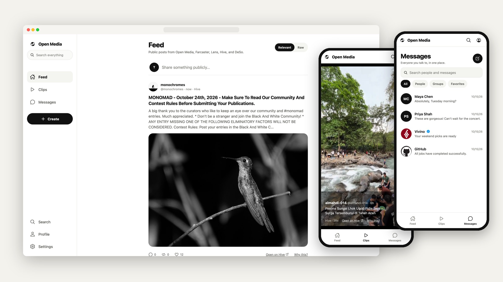
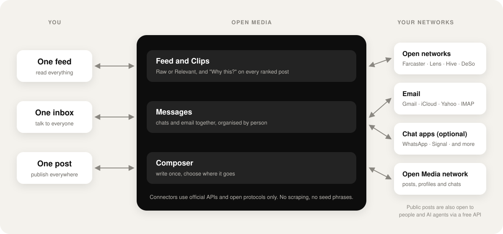
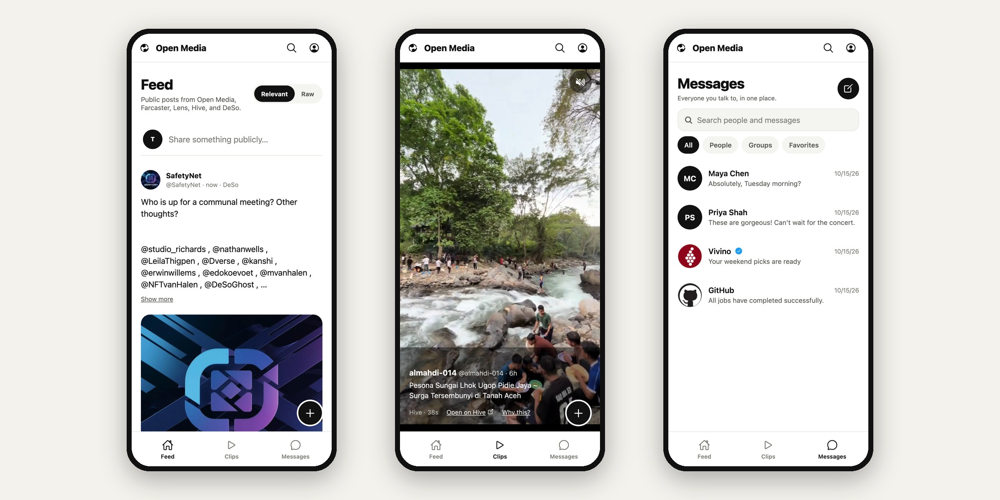
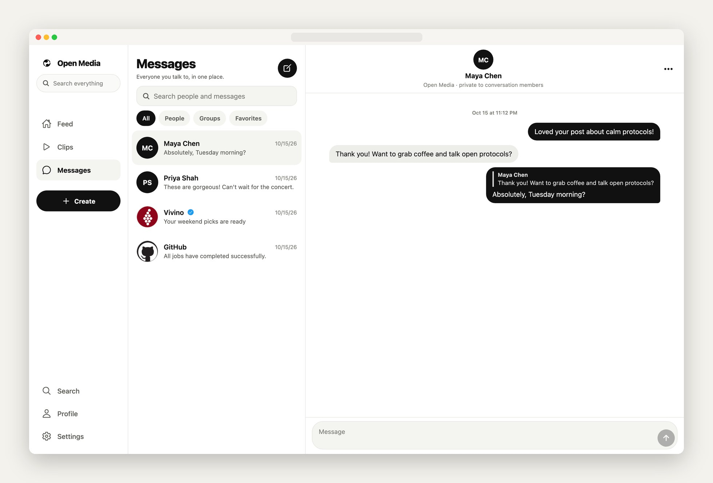
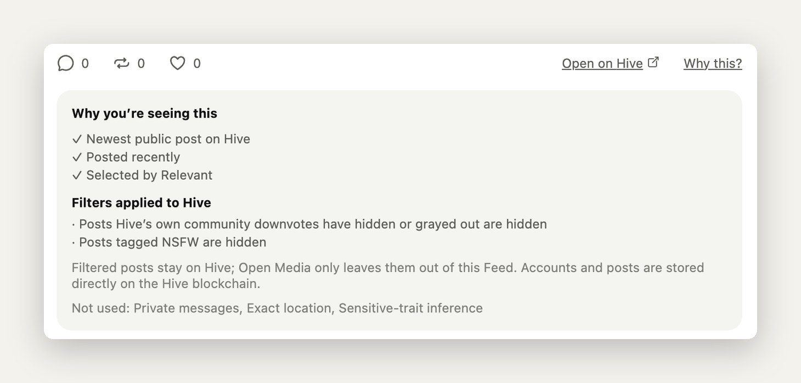
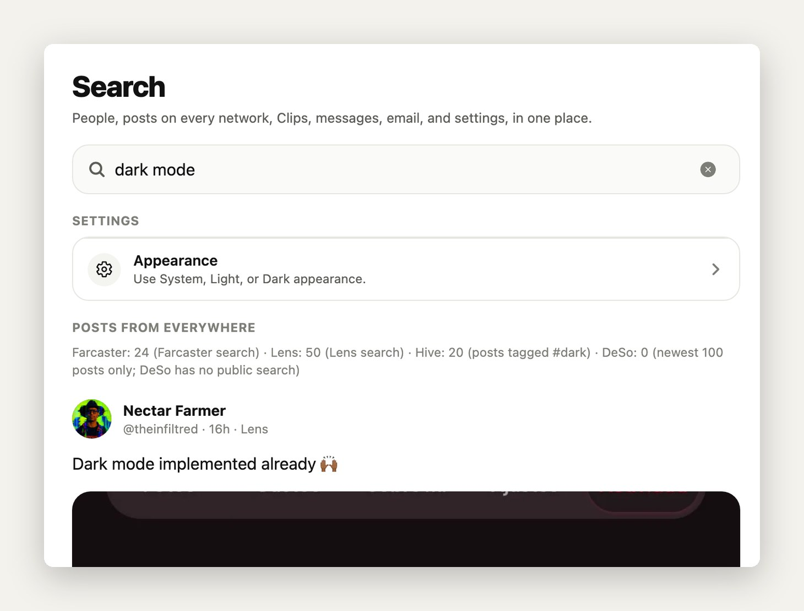
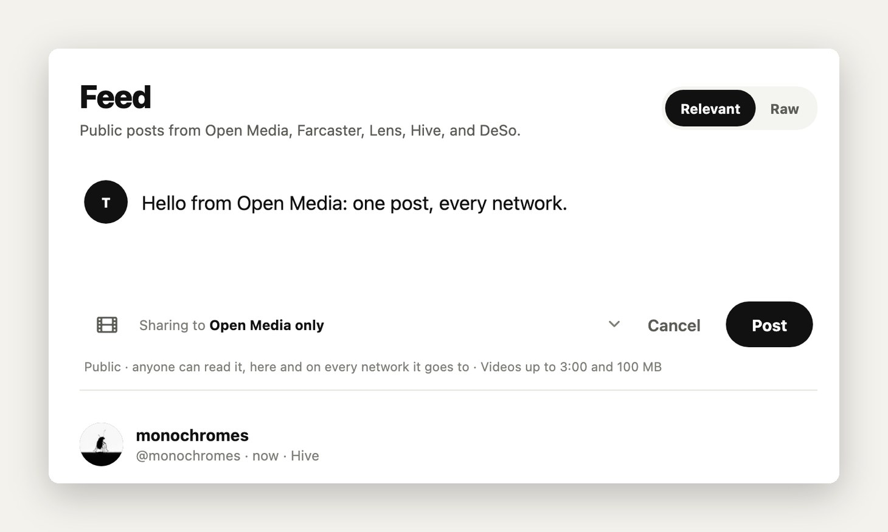
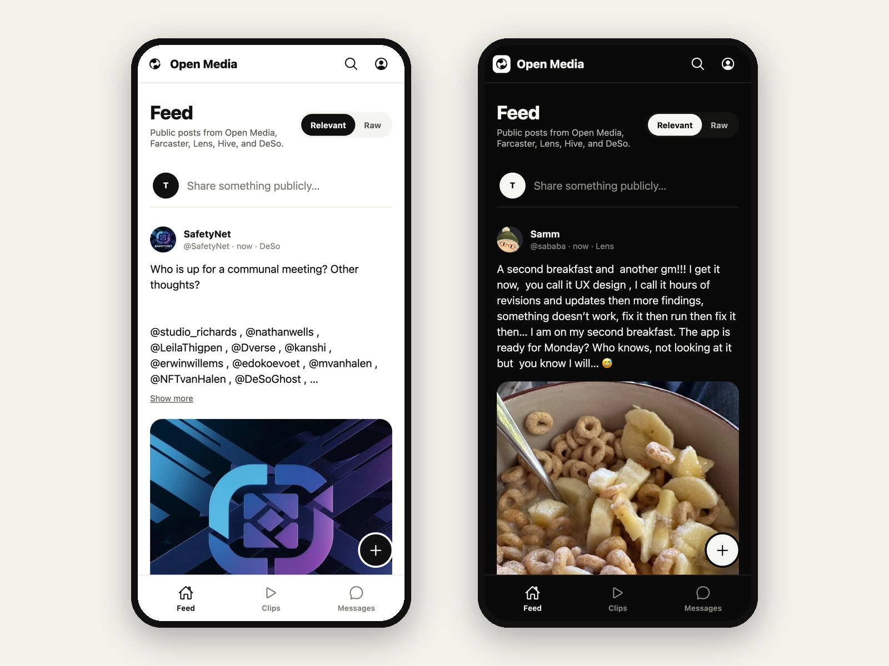

<p align="center">
  <picture>
    <source media="(prefers-color-scheme: dark)" srcset=".github/assets/logo-dark.png">
    
  </picture>
</p>

<h1 align="center">Open Media</h1>

<p align="center">
  <strong>Post everywhere. Message everyone. One app.</strong>
</p>

<p align="center">
  Open Media brings your whole social world into one simple app: one feed, one inbox, one post to every network.<br>
  Free, open source, and built so that <em>you</em>, not an app, own your identity, your audience and your feed.
</p>

<p align="center">
  <a href="LICENSE"></a>
  
  
  <a href="CONTRIBUTING.md"></a>
  <a href="https://github.com/mihirkavi/open-media/stargazers"></a>
</p>

<p align="center">
  <a href="#the-idea">The idea</a> ·
  <a href="#a-tour-of-the-app">Tour</a> ·
  <a href="#what-works-today">What works today</a> ·
  <a href="#for-developers-and-ai-agents">Agents</a> ·
  <a href="#the-bigger-vision">Vision</a> ·
  <a href="#roadmap">Roadmap</a> ·
  <a href="#faq">FAQ</a> ·
  <a href="#run-it-yourself">Run it</a> ·
  <a href="#contributing">Contribute</a>
</p>

<p align="center">
  
</p>

---

## The idea

**Today, every app owns a piece of you.** Your friends are on one app, your colleagues on another, your family on a third, and your email sits somewhere else. Each app decides what you see with a secret algorithm built to keep you scrolling. Each app also owns your followers, your posts and your conversations. If you leave, you start again from zero.

**Open Media flips that around.** It is one app that sits on top of the networks you already use. You read everything in one feed, talk to everyone from one inbox, and publish once to every network you choose. You decide how your feed is sorted, and every recommendation explains itself.

The principle behind every design decision is simple:

> **Apps are doorways. The person is the constant.**

No single app should permanently own your identity, your audience, your content, your feed or your message history. Open Media is one doorway into your social world. Over time, anyone will be able to build another doorway on the same open foundations, and you will be able to walk through whichever one you like, taking everything with you.

## The problem

| | What people live with today |
| --- | --- |
| **Scattered** | The average internet user is active on about seven social platforms every month ([DataReportal, Digital 2025](https://datareportal.com/reports/digital-2025-global-overview-report)). Conversations, posts and contacts are split across all of them. |
| **Manipulated** | Feeds are ranked by hidden algorithms that optimise for time spent, not for what you actually want to see. You cannot inspect them or switch them off. |
| **Locked in** | Your followers, posts and history belong to the platform. Moving means losing your audience, so people stay even when they are unhappy. |
| **Fragmented messaging** | Chats, DMs and email live in different apps, organised by app instead of by person. Finding "what did Sam last say?" means checking five places. |

## The solution: three promises

<table>
  <tr>
    <td width="33%" valign="top">
      <h3>1. Everything together</h3>
      <p><strong>One place for your social world.</strong> Posts from several networks in one feed. Every conversation, whether chat or email, in one inbox, organised by <em>person</em> rather than by app. One post goes out to every network you pick.</p>
    </td>
    <td width="33%" valign="top">
      <h3>2. Your feed belongs to you</h3>
      <p><strong>No secret algorithm.</strong> Choose <em>Raw</em> (simply newest first) or <em>Relevant</em> (a small, visible set of signals). Every ranked post has a <strong>Why this?</strong> button that shows exactly why it is there and which private data was <em>not</em> used.</p>
    </td>
    <td width="33%" valign="top">
      <h3>3. You are not locked in</h3>
      <p><strong>Your identity, audience and content move with you.</strong> Export everything or delete your account at any time. Your public posts are open to everyone through a free API. The long-term goal is identity and content that work in any app.</p>
    </td>
  </tr>
</table>

Most importantly, **Open Media is useful on day one, even if none of your friends have joined yet**, because it connects to the networks and inboxes you already have. It does not need its own network effect to be valuable.

## How it works

<p align="center">
  
</p>

Open Media never pretends a connection exists when it does not. Each network tells the app what it genuinely allows (reading, posting, messaging, and so on), and the app only shows those actions. Open Media never asks for your seed phrase or master password.

## A tour of the app

The app has just three main screens: **Feed**, **Clips** and **Messages**. Everything else (search, settings, your profile) stays out of the way until you need it.

<p align="center">
  
</p>

<table>
  <tr>
    <td width="50%" valign="top">
      <h3>Feed: everything in one stream</h3>
      <p>Public posts from Open Media, Farcaster, Lens, Hive and DeSo appear together. Switch between <strong>Relevant</strong> and <strong>Raw</strong> at the top. Anyone can read the feed without an account.</p>
    </td>
    <td width="50%" valign="top">
      <h3>Clips: short videos, full screen</h3>
      <p>Swipe through short videos from the same networks, one per screen. Clips are not a separate content type: the same post can be watched in Feed or in Clips.</p>
    </td>
  </tr>
</table>

### Messages: every conversation, organised by person

Chats with other Open Media users and your email sit side by side in one list. Reply to an email like a text message. Optionally bring in WhatsApp and other chat apps through bridges.

<p align="center">
  
</p>

<table>
  <tr>
    <td width="50%" valign="top">
      <h3>Why this? Every ranked post explains itself</h3>
      
      <p>See the reasons a post is shown, the filters that were applied, and the private data that was <em>not</em> used.</p>
    </td>
    <td width="50%" valign="top">
      <h3>One search for everything</h3>
      
      <p>Search posts on every network, your messages, your email and every setting, in plain language. Private data is searched on your device.</p>
    </td>
  </tr>
  <tr>
    <td width="50%" valign="top">
      <h3>Write once, publish everywhere</h3>
      
      <p>The composer shows exactly where a post will go. Connect networks once in Settings, and every post goes to all of them by default; you can leave any out for a single post.</p>
    </td>
    <td width="50%" valign="top">
      <h3>Light and dark, on every screen</h3>
      
      <p>A calm, black-and-white design that puts content first. One app on iPhone, Android, tablets and the web.</p>
    </td>
  </tr>
</table>

<sub>Screenshots are from the current app running locally. Feed and Clips show real public posts from open networks; the conversations shown are test data.</sub>

## What works today

Open Media is in **public beta**. Everything below is in the code today.

| Area | Available now | Status |
| --- | --- | --- |
| **Feed** | One feed mixing Open Media with Farcaster, Lens, Hive and DeSo. Raw and Relevant modes. "Why this?" on every ranked post. Readable without an account. | ✅ Live |
| **Clips** | Full-screen short videos from the same networks, with sound on tap and smooth loading. | ✅ Live |
| **Posting** | Text posts and short videos (up to 3 minutes). Location data is removed from videos before upload. Report and delete posts. | ✅ Live |
| **Cross-posting** | One post to Farcaster, Lens, Hive and DeSo using keys you approve in each network's own app. No seed phrases. | 🧪 Beta: built, not yet tested on live networks |
| **People** | Tap any name to open one profile with that person's posts from every network they list. Your own contacts, notes and nicknames are encrypted and visible only to you, link to accounts only on an exact email or phone match, and every link can be undone. | ✅ Live |
| **Privacy and follows** | Make your account private so only followers you approve see your posts, choose which name people see, and follow people. Verified people get a blue tick. | 🧪 Beta: verification turns on once Stripe Identity is configured |
| **Products, services and events** | Offer something for sale or a service from the composer, with a price, and people can message you about it. Verified people can rate listings from one to five stars (no written reviews). Upcoming public events from Luma, Meetup and Eventbrite appear in the Feed with a link to register on the official page. | 🧪 Beta: events cover the San Francisco Bay Area for now |
| **Payments** | Buy a product or service, tip a creator, or unlock a paid post, by card (on Stripe's page, paid straight to the seller's Stripe account) or in USDC on Base from your own wallet. Every payment shows the recipient, amount and fees first. Open Media never holds money and charges no fee for now. | 🧪 Test mode only: Stripe test cards and Base Sepolia, until live keys are approved |
| **Messages** | Real-time chats between Open Media users, blocking and reporting. | ✅ Live |
| **Email** | Connect Gmail, iCloud, Yahoo, Fastmail or any other IMAP account. Read and reply as conversations. Verified brand logos for trusted senders. | ✅ Live |
| **Chat bridges** | WhatsApp, Signal, Google Messages, Google Voice, Instagram, Messenger, LinkedIn, X, Bluesky, Slack and Discord through open-source bridges, with Telegram ready once its app ID is set. Opt-in, with a clear warning and step-by-step sign-in for each network. | 🧪 Beta: local setup only |
| **Search** | Posts on every network, messages, email and settings in one box, in plain language, with a short AI summary of public results. | ✅ Live |
| **Privacy** | Export all your data or delete your account from your profile. Messages, email and contacts are never public. | ✅ Live |
| **For developers and AI agents** | Everything above has an interface: a public API for the mixed feed, cross-network search, networks, settings and the mission; an account API to post, message and export; MCP servers for AI assistants; and `llms.txt` and OpenAPI for discovery. | ✅ Live |
| **Events** | Ask ChatGPT, Claude or another AI assistant to find events, check your calendar and plan your week. | 🧪 Beta |

The full list, including every known limitation, is in the [technical overview](docs/TECHNICAL_OVERVIEW.md).

## For developers and AI agents

Everything Open Media does for people, it also offers to programs and AI assistants, through documented interfaces that share the app's own code.

| Interface | Account needed | What you can do |
| --- | --- | --- |
| `GET /v1/feed`, `/v1/search`, `/v1/posts`, `/v1/profiles/{handle}`, `/v1/people/{network}/{handle}`, `/v1/events/upcoming`, `/v1/networks`, `/v1/settings`, `/v1/about` | No | Read the mixed feed with “Why this?” reasons, search every open network in plain language, read public posts, profiles and one person's posts across networks, find upcoming events, see exactly what each network supports, find any setting, read the mission |
| `/v1/me`, `/v1/me/posts`, `/v1/me/conversations`, `/v1/me/contacts`, `/v1/me/identity`, `/v1/me/follows`, `/v1/me/listings`, `/v1/me/payments`, `/v1/me/export` | Your access token | Publish, delete and report posts, offer products and services, pay, tip and unlock (always previewed and confirmed first), read and send messages, manage your private contacts, privacy and follows, export your data |
| MCP: `/open/mcp`, `/me/mcp` and `/docs/mcp` | No / your access token / no | The same as tools for Claude, ChatGPT and other assistants, plus searchable documentation |
| WebMCP | No | Every page of the API site and the web app registers read-only tools (search, feed, events, profiles) through `document.modelContext` for agents in the browser |
| `POST /ask` (NLWeb v0.55) | No | Ask in plain language; answers are schema.org items from the docs and every open network, as JSON or a stream of events |
| `POST /agent/identity` | No | An agent registers itself and trades the assertion at `/oauth/token` (JWT-bearer grant) for a read-only token with its own rate limit; it never opens anyone's account |
| Discovery | No | `/llms.txt`, `/agents.md`, `/auth.md`, `/docs`, `/v1/openapi.json`, `/sitemap.xml`, `/.well-known/ard.json`, `/.well-known/agent-skills/index.json`, `/.well-known/agent-card.json`, `/.well-known/api-catalog`, `/schemamap.xml`, `/feeds/posts.jsonl` and MCP server cards; every page also answers in Markdown (`Accept: text/markdown` or `.md`) |

```json
{ "mcpServers": { "open-media": { "url": "https://<open-media-api>/open/mcp" } } }
```

### SDK, command line and Python client

[`packages/`](packages) holds a typed TypeScript SDK (`open-media-sdk`), a command line (`open-media`: `feed`, `search`, `events`, `profile`, `timeline`, `me`, `post --yes`, `payments`, `mcp-config`, all with `--json`) and a Python client. They are not on npm or PyPI yet; build them from source (see [packages/README.md](packages/README.md)). `npm run packages:test` runs their tests.

### Plugin for Claude Code and Codex

The [agent-plugin](agent-plugin) folder bundles the three MCP servers and two skills (using Open Media, and paying safely):

```
/plugin install open-media --marketplace mihirkavi/open-media
```

```bash
codex plugin marketplace add mihirkavi/open-media && codex plugin add open-media@open-media
```

Set `OPEN_MEDIA_TOKEN` to use your own account from the plugin. Your access token comes from **Settings → Developers and agents** in the app and expires after about an hour. Every account call acts only as you; the database refuses anything else. See [ADR 0012](docs/adrs/0012-agent-interfaces-and-design-system.md) and the [public API guide](services/mail-sync/PUBLIC_API.md).

## Why now

1. **Open social networks are finally real.** Farcaster, Lens, Hive and DeSo let any app read and publish posts without permission from a gatekeeper. For the first time, a single app can be a full citizen of many networks.
2. **People are tired of being the product.** Frustration with addictive, opaque feeds is mainstream, and regulators in Europe and elsewhere now require more transparency about recommendations and easier data portability.
3. **AI assistants need open, trustworthy data.** People increasingly ask AI agents to read, search and act for them. Open Media's public posts are open to agents by design, and its events service already works inside AI assistants.
4. **One codebase can now reach every device.** Modern cross-platform tools let a small team ship one polished app to iPhone, Android and the web at the same time.

## How it is different

| | Big social apps | Aggregators and unified inboxes | **Open Media** |
| --- | --- | --- | --- |
| Brings several networks together | No | Some | **Yes**, through official APIs and open protocols |
| Messaging and email in one place | No | Some | **Yes**, organised by person |
| You choose how your feed is ranked | No | Rarely | **Yes**, with "Why this?" on every ranked post |
| Explains what data is *not* used | No | No | **Yes** |
| Your data leaves with you | Partly | Partly | **Full export and deletion today; portable identity is the goal** |
| Open source | No | Usually not | **Yes (MIT)** |
| Public posts open to everyone, including AI agents | No | No | **Yes, through a free API** |
| Advertising | Core business | Varies | **None by default** |

## The bigger vision

> **Mission: build the open communication layer for humanity, where people can talk across networks, control how information reaches them, and keep ownership of their identity, relationships and content, whichever app they use.**

Open Media starts as an app, but the goal is bigger than any single app, network, blockchain or aggregator. The aim is an **open protocol for human communication**: shared rules that many apps can use, so that no company, including Open Media itself, can lock people in.

**If Open Media the company disappeared, the network should keep running.** It should never depend on one company, one server, one algorithm, one moderator, one storage provider or one payment provider.

### What that means in practice

<table>
  <tr>
    <td width="50%" valign="top">
      <h4>🧭 Algorithms you can choose</h4>
      <p>Feed algorithms become optional "lenses" that anyone can create, inspect, rate, install or remove, like apps in an app store. Each one declares what data it uses, and it can never touch your private messages, ID documents or exact location.</p>
    </td>
    <td width="50%" valign="top">
      <h4>🛡️ Safety without censorship-by-default</h4>
      <p><em>Filtering is normal; global deletion is exceptional.</em> You, your communities and your region choose filters, including filters from independent moderation providers. Report counts are signals weighed by credibility, never an automatic delete button that a mob can abuse.</p>
    </td>
  </tr>
  <tr>
    <td width="50%" valign="top">
      <h4>🙋 Real people, private by default</h4>
      <p>Optional proof that you are a real, unique human, without uploading or storing your passport or biometrics. You can keep several separate personas that cannot be linked to each other publicly. Proof is needed only where it matters, such as voting.</p>
    </td>
    <td width="50%" valign="top">
      <h4>🗳️ One person, one vote</h4>
      <p>The open protocol is governed by people, not money. One verified human gets one vote, never one token or one dollar. Core rights (algorithm choice, data portability, the right to fork) are protected from easy change.</p>
    </td>
  </tr>
  <tr>
    <td width="50%" valign="top">
      <h4>🔗 Blockchain proves; it does not host</h4>
      <p>Blockchains are used only where they add trust, such as proving who wrote something or recording a vote. You will never need a crypto wallet, tokens or knowledge of "gas" just to post or chat.</p>
    </td>
    <td width="50%" valign="top">
      <h4>🤖 Honest about AI</h4>
      <p>AI agents can take part, but always as clearly labelled agents, never posing as humans. AI-generated media is disclosed, and agents cannot message you unless you allow it.</p>
    </td>
  </tr>
  <tr>
    <td width="50%" valign="top">
      <h4>🔒 Private messages stay private</h4>
      <p>Open Media's own private messages will use mature, reviewed end-to-end encryption. Email and bridged chats are always labelled honestly, so you know which conversations are protected.</p>
    </td>
    <td width="50%" valign="top">
      <h4>💸 Money buys services, not power</h4>
      <p>No ads by default, no required token, and no speculative coin. Creators will be able to earn through subscriptions, tips and memberships using whichever payment method they prefer.</p>
    </td>
  </tr>
</table>

### Our principles

- **Post everywhere. Message everyone. One app.**
- **Your feed belongs to you.**
- **Your identity, audience and content move with you.**
- **Apps are doorways. The person is the constant.**
- **Protocol rules decide how apps work together. Each app decides how things look.**
- **Build one app today as though competing apps will exist tomorrow.**
- **Obvious before powerful, and powerful when needed.**

The complete vision, with every principle and the reasoning behind it, is in the [Master Builder Prompt](Open%20Media%20%E2%80%94%20Master%20Builder%20Prompt.md). A shorter summary is in [docs/MASTER_BUILDER_PROMPT.md](docs/MASTER_BUILDER_PROMPT.md).

## Roadmap

| Phase | What it delivers | Status |
| --- | --- | --- |
| **1. The app** | Feed, Clips and Messages on iPhone, Android and web, with light and dark mode | ✅ Done |
| **2. Shared content** | One post type used everywhere, posts from four open networks, short video | ✅ Done |
| **3. Email and Messages** | Email inside Messages, chats organised by person | ✅ Done |
| **4. Connectors** | Cross-posting to open networks, chat bridges, public API | 🧪 In beta |
| **5. Search and AI help** | One search for posts, messages, email and settings, in plain language | ✅ Done (first version) |
| **6. Algorithm choice** | A marketplace of feed algorithms with strict data permissions | 🔜 Next |
| **7. Moderation choice** | User-set filtering, credible reports and independent moderation providers | 🔜 Planned |
| **8. Identity** | Optional proof of personhood, separate personas, portable identity | 🔜 Planned |
| **9. Governance** | One-person-one-vote and an open improvement-proposal process | 🔜 Planned |
| **10. Decentralisation** | Independent apps and infrastructure, stewarded by an independent foundation | 🔭 Long term |

## Who it is for

- **People** who are tired of juggling apps and want one calm place for their friends, feeds and inbox, with a feed they control.
- **Creators** who want to reach every network with one post and keep their audience, whichever platform rises or falls.
- **Developers and AI builders** who want open, documented access to public posts and a clean, open-source codebase to build on.
- **Partners and investors** who believe the next era of social media is open, user-owned and interoperable, and want to back the app that makes it simple enough for everyone.

## FAQ

<details>
<summary><strong>Is Open Media free?</strong></summary>
<br>
Yes. The app and its source code are free and open source under the MIT license. There are no ads by default.
</details>

<details>
<summary><strong>Do my friends need to join for it to be useful?</strong></summary>
<br>
No. Open Media is designed to be useful on day one by connecting the networks and email accounts you already use. Friends on Open Media are a bonus, not a requirement.
</details>

<details>
<summary><strong>Can it show my Instagram, X, TikTok or LinkedIn feed?</strong></summary>
<br>
Not today. Those companies do not offer open access for apps like Open Media, and Open Media does not scrape them. It connects to networks that allow it (Farcaster, Lens, Hive, DeSo and email) and will add others as official access becomes available. For messaging only, optional open-source bridges can bring in chats from WhatsApp and similar apps, with a clear warning first.
</details>

<details>
<summary><strong>Do I need a crypto wallet?</strong></summary>
<br>
No. You sign in with your email. Some open networks use blockchain technology behind the scenes, but you never need to understand it, hold tokens or pay fees to read the feed.
</details>

<details>
<summary><strong>Is my data safe?</strong></summary>
<br>
Your messages, email and contacts are private and never shown publicly. Email passwords are encrypted on the server, and the database only lets each person see their own data. You can export everything or delete your account at any time. Open Media's own messages are not end-to-end encrypted yet; that is planned using a mature, reviewed standard.
</details>

<details>
<summary><strong>Who owns my posts?</strong></summary>
<br>
You do. Posts you publish on Open Media are public and open to everyone through a free API, which is the point: your words are not trapped inside one company. You can delete a post at any time, although copies others already saw cannot be recalled.
</details>

<details>
<summary><strong>How does Open Media make money?</strong></summary>
<br>
The protocol does not require any single business model. The Open Media app ships with no ads by default. Future options include optional paid services (such as extra storage, premium algorithms or moderation providers) and creator tools. Money will never buy influence over how the protocol is governed.
</details>

## Honest status

Open Media is an early beta, built in the open. To be clear about where it stands:

- Cross-posting to open networks is built and follows each network's official tools, but has not yet been tested end to end on live accounts.
- Chat bridges for WhatsApp, Instagram, Discord and the other chat apps currently run only on a local setup, have not yet been connected to real accounts, and are not approved by those companies, so accounts could be limited. iMessage, Snapchat and TikTok cannot be bridged.
- Videos are stored as uploaded, without streaming optimisation.
- Messages between Open Media users are protected by strict database rules but are **not yet end-to-end encrypted**.
- The algorithm marketplace, moderation choice, identity and governance described above are the vision, not features you can use today.

Every limitation is listed in the [technical overview](docs/TECHNICAL_OVERVIEW.md#honest-limitations).

## Run it yourself

Open Media is one TypeScript codebase ([Expo](https://expo.dev) and React Native) for iPhone, Android and the web, with [Supabase](https://supabase.com) for accounts and data and a [Cloudflare Worker](https://workers.cloudflare.com) for email, the public API and events.

**Requirements:** Node.js 22.13 or newer (`nvm use`), npm and Docker Desktop. Xcode or Android Studio only for the phone simulators.

```bash
git clone https://github.com/mihirkavi/open-media.git
cd open-media
npm install
npm run local
```

This starts everything on your computer (database, sign-in, email service, public API and the web app) and opens <http://localhost:8081>. Sign-in codes go to a local test inbox and are filled in for you. Stop the database with `npm run local:stop`.

Run on a phone simulator:

```bash
npm run ios
npm run android
```

Before sending a change, run the checks:

```bash
npm run check
npm run test:db
```

### Learn more

| Document | What it covers |
| --- | --- |
| [Technical overview](docs/TECHNICAL_OVERVIEW.md) | Every feature, the architecture, configuration and known limitations |
| [Public API](services/mail-sync/PUBLIC_API.md) | Reading public Open Media posts and profiles as JSON |
| [Architecture decisions](docs/adrs) | The short records behind each major choice |
| [Open Media Events](docs/events/README.md) | The event-planning service for AI assistants |
| [Production readiness](docs/PRODUCTION_READINESS.md) | What is needed to run Open Media in production |
| [Master Builder Prompt](Open%20Media%20%E2%80%94%20Master%20Builder%20Prompt.md) | The full product vision and principles |

## Contributing

Open Media is built in the open, and contributions of every size are welcome: bug reports, ideas, design feedback, documentation and code.

- Read [CONTRIBUTING.md](CONTRIBUTING.md) to get set up and learn how changes are reviewed.
- Open an [issue](https://github.com/mihirkavi/open-media/issues) to report a bug or suggest an idea.
- Report security problems privately as described in [SECURITY.md](SECURITY.md).

The `main` branch is protected: every outside change goes through a pull request and is reviewed by the maintainer before it is merged.

## License

Open Media is released under the [MIT License](LICENSE).

<p align="center">
  <br>
  <picture>
    <source media="(prefers-color-scheme: dark)" srcset=".github/assets/logo-dark.png">
    
  </picture><br>
  <sub><strong>Open Media</strong> · Your social world, together.</sub>
</p>
