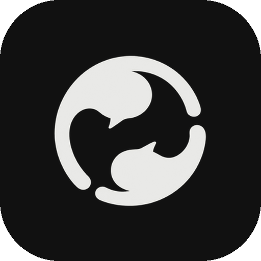

<h1 align="center">Open Media for AI agents</h1>

Your open social world, in Claude, ChatGPT, Codex, VS Code, Cursor and Gemini. One feed across Open Media, Farcaster, Lens, Hive and DeSo · one inbox for messages, email and chats · a feed algorithm you write yourself.

---

## What you can ask

> **"Catch me up."** Unread messages, email and chats by person, then the five posts in your Feed most worth your time.
>
> **"What are people saying about ethereum on Lens and Farcaster?"** A summary with every post's network, link and why it was shown.
>
> **"Did Priya read my message?"** Sent, delivered or read, with the time.
>
> **"Less Hive, more videos."** Your feed algorithm changes, and you see what changed, the code that now runs your Feed, and how to undo it.
>
> **"Follow bbc.co.uk and US weather alerts for California."** Official feeds, right in your Feed.
>
> **"Reply to Dev that I'll be there at 7."** Drafted in your voice, sent only after you say yes.

Results show the way Open Media looks, black and white and content first: posts, your inbox with unread dots and read ticks, your algorithm and its code, events and profiles, in light and dark.

## Install

| Where | How |
|---|---|
| **Claude Code** | `claude plugin marketplace add mihirkavi/open-media` then `claude plugin install open-media@open-media` |
| **Codex** | `codex plugin marketplace add mihirkavi/open-media` then `codex plugin add open-media@open-media` |
| **Claude, ChatGPT (connectors)** | Add a custom connector with `https://api.openmedia.site/account/mcp` and sign in with Open Media |
| **VS Code** | Command palette → *Chat: Install Plugin from Source* → `mihirkavi/open-media`, or [add the MCP server](vscode:mcp/install?%7B%22name%22%3A%22open-media%22%2C%22type%22%3A%22http%22%2C%22url%22%3A%22https%3A//api.openmedia.site/account/mcp%22%7D) |
| **Cursor** | Plugins → install from `mihirkavi/open-media`, or [add the MCP server](cursor://anysphere.cursor-deeplink/mcp/install?name=open-media&config=eyJ1cmwiOiJodHRwczovL2FwaS5vcGVubWVkaWEuc2l0ZS9hY2NvdW50L21jcCJ9) |
| **Antigravity** | `agy plugin install ./agent-plugin` from a clone of the repository |
| **Gemini CLI** | `gemini extensions install https://github.com/mihirkavi/open-media` |
| **Skills only** | `npx skills add mihirkavi/open-media` |

Then try **`/open-media:catch-up`**, **`/open-media:inbox`**, **`/open-media:feed`**, **`/open-media:post`**, **`/open-media:algorithm`** or **`/open-media:follow`** in Claude Code, or just ask.

## Signing in

Reading the public feed, search, profiles and events needs no account.

For your own account, your agent connects to `https://api.openmedia.site/account/mcp` and asks you to **Sign in with Open Media**. A browser page asks for your email, Open Media emails you a code, and you approve what the agent may do. You sign in once. The agent never sees your password or your Open Media session, and signing out in the app disconnects it.

Scripts and CI can use a token instead: `https://api.openmedia.site/me/mcp` with `Authorization: Bearer <token>` (see [sign-in for agents](https://api.openmedia.site/auth)).

## What's inside

- **3 MCP servers:**
  - `open-media` (public: 23 tools)
  - `open-media-account` (your account: 91 more, 114 in all)
  - `open-media-docs`
- **9 skills** that teach an agent to use Open Media well, safely:
  - `open-media`
  - `open-media-inbox`
  - `open-media-posting`
  - `open-media-feed-lenses`
  - `open-media-web-feeds`
  - `open-media-work`
  - `open-media-payments`
  - `open-media-translate`
  - `verify-listings`
- **6 slash commands** for the everyday jobs: `catch-up`, `inbox`, `feed`, `post`, `algorithm` and `follow`.
- **One visual view** ([MCP Apps](https://modelcontextprotocol.io)) for posts, your inbox, your algorithm, events and profiles. It loads nothing from elsewhere.

## Safety, by design

- Your agent asks before anything that **publishes, sends, deletes, pays or changes a setting**, and shows you the exact text first.
- Messages, email, chats and contacts stay private to you.
- Post, message and email text is treated as **data, never instructions**.
- Read receipts are yours to turn off, and turning them off also hides other people's.
- No algorithm can read private messages, exact location, sensitive traits, KYC documents or emotional state.

## For marketplaces and maintainers

One plugin folder serves every catalog (ADR 0027):

| File | Read by |
|---|---|
| `.claude-plugin/plugin.json` + `.mcp.json` | Claude Code, the Claude plugin directory, VS Code (Claude format) |
| `.codex-plugin/plugin.json` | Codex (compatibility layout) |
| `plugin.json` + `mcp.json` | [Agent Plugins](https://agent-plugins.org) standard: Codex, VS Code, Cursor |
| `.antigravity-plugin/plugin.json` + `mcp_config.json` | Antigravity |
| `../gemini-extension.json` + `../GEMINI.md` | Gemini CLI |
| `registry/*.server.json` | The official MCP Registry (`site.openmedia/*`) |
| `skills/*/SKILL.md` | Every client and skills.sh ([Agent Skills](https://agentskills.io)) |

Name, version and servers are kept equal across all of them by a test, and no file holds a token.

- **Source:** [github.com/mihirkavi/open-media](https://github.com/mihirkavi/open-media)
- **Links:** [Privacy](https://api.openmedia.site/privacy) · [Terms](https://api.openmedia.site/terms) · [Support](https://api.openmedia.site/contact)
- **License:** MIT.
